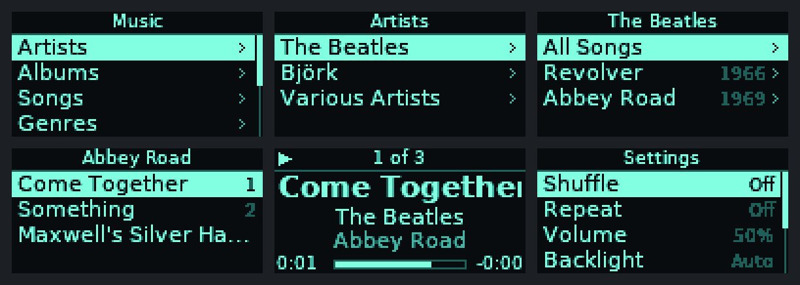
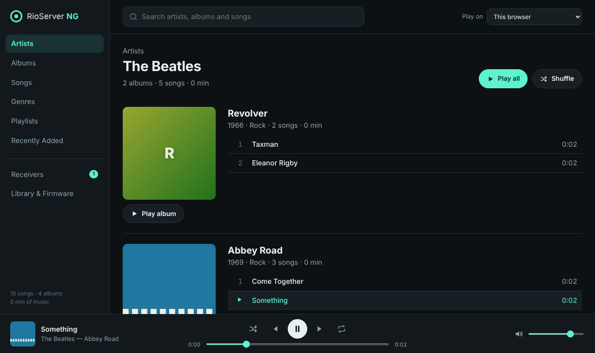

# RioServer NG

A modern replacement for the server software of the **Rio Receiver** and the
**Dell Digital Audio Receiver**. Both are 2001-era network MP3 players that
contain no music and very little software of their own. Each time they power
on they download their operating system from a PC on the network and then
stream music from it. The original server only ran on Windows, listed
everything alphabetically, had no web interface and needed a manual rescan
whenever you added music.

RioServer NG runs in Docker. It provides:

- **iPod-style menus on the receiver.** The project includes new receiver
  firmware: Music › Artists › Albums › Songs, with albums in release order and
  tracks in album order. There are also Albums, Songs, Genres, Playlists,
  Recently Added, Shuffle Songs, a Now Playing screen and Settings.
- **A web interface** for browsing by artist › album › track list, with album
  art and search. You can play music in the browser or send it to any
  receiver and control playback from there. Commands reach the receiver
  instantly. Receivers can be given names ("Kitchen") and have a sleep timer
  that fades out and pauses.
- **Chromecast and Google speakers.** Chromecasts, Chromecast Audio, Google
  Home and Nest speakers, speaker groups, and speakers and TVs with
  Chromecast built-in show up next to your receivers, and you can send music
  to them the same way. See [Chromecast and Google speakers](#chromecast-and-google-speakers).
- **Automatic library updates.** Music added to, changed in or removed from
  the mounted folder shows up within seconds. A periodic rescan catches
  anything the file watcher misses.
- **Network boot.** The server hosts the receiver firmware and answers the
  receiver's discovery, portmapper, mount and NFS requests itself. You don't
  need an NFS server on the host or a Windows PC.
- **Support for the original firmware.** The classic Rio protocol is fully
  implemented, so receivers running SonicBlue/Dell's player work too, with
  tracks returned in album order.



*The RioServer NG firmware's screens on the receiver's 128×64 display
(captured from the emulator used by the tests).*



## Quick start

1. Install Docker on a Linux machine on the same network (and the same subnet)
   as your receivers.
2. Edit `docker-compose.yml` and point the music volume at your MP3 folder:

   ```yaml
   volumes:
     - /srv/music:/music:ro
     - rio-data:/data
   ```

3. Start it:

   ```sh
   docker compose up -d --build
   ```

4. Open `http://<server>:8080/` in a browser, then power-cycle your receivers.
   They find the server, boot the new firmware and appear under **Receivers**
   in the web interface.

The container uses **host networking**. Receivers find the server through UDP
broadcasts and then mount their firmware over NFS, and neither works through
Docker's port mapping. Docker Desktop on macOS and Windows doesn't support
host networking, so run the server on a Linux host (a Raspberry Pi or NAS
works fine).

### Without Compose

```sh
docker build -t rioserver-ng .
docker run -d --name rioserver --network host --restart unless-stopped \
  -v /srv/music:/music:ro -v rio-data:/data rioserver-ng
```

### Umbrel

RioServer NG is in the [msalty Umbrel community app store](https://github.com/msalty/msalty-umbrel).
In umbrelOS, open **App Store › ⋯ › Community App Stores**, add
`https://github.com/msalty/msalty-umbrel`, and install **RioServer NG**. Put
your MP3s in **Files › Downloads › music**. The web interface is on port 12078.

The app uses the multi-arch image `ghcr.io/msalty/dell-rio-server`, which
`.github/workflows/publish.yml` builds for every push to `main` and every
`v*` tag.

### On your phone

The web interface can be installed as an app, with its own home-screen icon
and no browser bars:

- **iPhone and iPad:** open the web interface in Safari, tap **Share › Add to
  Home Screen**.
- **Android:** open it in Chrome, tap **⋮ › Add to Home screen › Install**.
  Chrome only installs apps from HTTPS addresses. Over plain
  `http://<server>:8080/` it adds a shortcut that opens in a browser tab
  instead. To get the full app, put the server behind an HTTPS reverse proxy
  (for example Caddy, or `tailscale serve` if you use Tailscale).

## Requirements on your network

- **DHCP.** Receivers get their address from DHCP, so a normal home router is
  all you need.
- **Free ports on the Docker host.** The server uses:

  | Port | Purpose |
  |------|---------|
  | 21075/udp | receiver discovery (SSDP) |
  | 111/udp+tcp | portmapper (network boot) |
  | 627/udp+tcp | NFS mountd (network boot) |
  | 2049/udp+tcp | NFS (network boot) |
  | 12078/tcp | Rio music protocol, the web interface, and the music Chromecasts fetch |
  | 8080/tcp | web interface |
  | 5353/udp | finding Chromecasts (mDNS) |

  The server also sends small UDP datagrams to port 21076 on NG receivers,
  so they act on web-interface commands at once, and connects to cast
  devices on port 8009 (speaker groups use a port of their own).

  If the host already runs `rpcbind` (common when it mounts or exports NFS
  shares), set `RIO_PORTMAP_PORT` to an unused port. If the receiver can't
  reach a portmapper, its kernel falls back to the standard mountd and NFS
  ports (627 and 2049), so booting still works. If the host is itself an NFS
  server, port 2049 is taken. In that case either stop the host's NFS server
  or set `RIO_ENABLE_BOOT=0` and serve the firmware some other way.

## Configuration

All settings are environment variables.

| Variable | Default | |
|---|---|---|
| `RIO_MUSIC_DIR` | `/music` | music folder inside the container |
| `RIO_DATA_DIR` | `/data` | database, settings and your own firmware images |
| `RIO_SERVER_IP` | auto | address to advertise to receivers; set it if the host has several networks |
| `RIO_HTTP_PORT` | `12078` | Rio protocol port (the port the original server used) |
| `RIO_WEB_PORT` | `8080` | extra port for the web interface (`0` to disable) |
| `RIO_FIRMWARE` | `ng` | firmware to boot: `ng`, `rioplay`, or a file name in `/data/firmware` |
| `RIO_ENABLE_BOOT` | `1` | set to `0` to disable SSDP boot replies, portmapper and NFS |
| `RIO_PORTMAP_PORT` / `RIO_MOUNTD_PORT` / `RIO_NFS_PORT` | `111` / `627` / `2049` | network-boot ports |
| `RIO_RESCAN_INTERVAL` | `900` | seconds between periodic rescans (`0` = never) |
| `RIO_WATCH` | `1` | rescan as soon as files change |
| `RIO_WATCH_POLLING` | `0` | poll for changes instead of using inotify (needed for SMB/NFS-mounted music) |
| `RIO_CAST` | `1` | find Chromecasts and Google speakers so music can be sent to them (`0` to disable) |
| `RIO_CLASSIC_SHOW_COUNTS` | `0` | show "Name (12)" in the original firmware's menus |
| `RIO_LOG_LEVEL` | `INFO` | `DEBUG` logs every request |

Only `.mp3` files are indexed. That's all the receiver hardware can play.
Tags are read from ID3v1/ID3v2. Files without tags are named from an
`Artist/Album/NN - Title.mp3` folder layout. Albums are grouped by *album
artist*, so compilations tagged with an album artist such as "Various
Artists" stay together. `.m3u`/`.m3u8` files in the music folder become
playlists. Album art comes from embedded pictures or from a
`cover.jpg`/`folder.jpg` file in the album folder. Artist pictures come from an
`artist.jpg` in the artist's folder (the convention Plex and Kodi use), or
otherwise from the artist's newest album cover.

## Chromecast and Google speakers

The server finds cast devices on the network by itself (over mDNS, which is
another reason the container needs host networking). They appear under
**Receivers** and in the **Play on** menu. Pick one and play an album,
playlist or song as you would on a receiver. Play/pause, next, previous,
seek, volume, names and the sleep timer all work the same way.

Each track plays through Google's standard media player on the device, with
its title, artist and cover art. The device downloads the MP3 straight
from this server on port 12078, so the server must be reachable from the
device at the address it detects (set `RIO_SERVER_IP` if the host has
several networks).

- **Speaker groups** made in the Google Home app show up as a device of
  their own, so music plays in sync across every speaker in the group.
- **The server keeps the play queue.** The device is given one track at a
  time, and when it reports that a track has finished the server starts the
  next one. Expect a short gap between tracks.
- **Another app wins.** If someone casts Spotify or YouTube to the device,
  the server's queue for it ends and the card shows the app in use.

## Firmware

The server can boot receivers into three kinds of firmware. Choose one under
**Library & Firmware** in the web interface (the choice is remembered), or
set `RIO_FIRMWARE`.

### RioServer NG (default)

The new player in [`firmware/`](firmware/), built from source during the
Docker build:

| Control | Remote | Front panel |
|---|---|---|
| Scroll | ▲ / ▼ | turn the knob |
| Select | Enter | press the knob |
| Back | Menu | Menu |
| Play the highlighted item / play-pause | Play | Play |
| Next / previous track | ⏭ / ⏮ | ⏭ / ⏮ |
| Volume | Vol + / – | knob, on the Now Playing screen |
| Shuffle on/off | Random | Random |
| Standby | Power | Power (hold 5 s to restart) |

Choosing a song plays the rest of that list (the album, playlist and so on)
starting at that song, as an iPod does. The menu tree comes from the server,
so browsing can be improved without reflashing anything. The receiver also
reports what it's playing to the server every few seconds, which lets the
web interface show it and send it music.

The image consists of the RioServer NG player as `/sbin/init`, plus the
Linux 2.2.14 kernel and HomePNA driver from the open-source RioPlay project.
Those two files are downloaded from SourceForge with pinned checksums during
the build.

The kernel draws a "DELL" or "Rio" logo while it boots. The build replaces
those screens with the RioServer NG logo (`firmware/tools/kernel_splash.py`;
needs `zopfli`). The receiver's boot loader in flash has its own copy of the
first screen, so the old logo still appears for a moment at power-on. From the
moment the kernel is downloaded, the receiver shows the new one.

### RioPlay 0.29

David Flowerday's 2002 open-source player is included for comparison. It has
flat menus and also supports Shoutcast streams.

### The original SonicBlue/Dell firmware

That firmware is copyrighted and isn't distributed here. If you have the
original Rio/Dell server installation, copy its `receiver.arf` into the
`firmware` folder of the data volume (`/data/firmware`) and select it in the
web interface. RioServer NG implements the protocol it speaks
(`/tags`, `/query`, `/results`, `/list`, `/content`, `/layout`) and answers
in album/track order. It also offers every album as a playlist, so even the
stock menus can play an album in order.

## How the receiver boots

1. The receiver gets an address over DHCP. Its kernel then broadcasts
   `upnp:uuid:1D274DB1-…` to UDP port 21075, and the server replies with
   `http://<server>/descriptor.xml`.
2. The kernel asks the portmapper on port 111 where mountd and NFS are,
   mounts its root filesystem over NFSv2 and runs `/sbin/init`. The
   filesystem is served directly from the firmware's `.arf` archive.
3. The player broadcasts `upnp:uuid:1D274DB0-…`, receives
   `http://<server>:12078/descriptor.xml` and from then on talks HTTP.

[docs/PROTOCOL.md](docs/PROTOCOL.md) documents every message.

## Development

```sh
# server
pip install -r server/requirements.txt pytest pytest-asyncio
cd server && python -m pytest

# firmware (needs arm-none-eabi-gcc and zopfli; tests also need qemu-arm,
# ffmpeg and `pip install unicorn`)
make -C firmware
```

`firmware/tools/simulate.py` runs the real firmware binary under `qemu-arm`
with the display, remote and audio replaced by files. The end-to-end test
uses it to browse Artist › Album on a simulated receiver and check that
playback follows album order. It also renders the display screenshots
above.

## Security

Like the original server, the music protocol, network boot and web interface
have no authentication. Run the server only on a trusted home network.

## Status

**Tested on real hardware.** A physical receiver network-boots the RioServer
NG firmware from the Docker container, browses the library and plays music.

The automated tests also exercise everything in emulation: the server's boot,
NFS, protocol and web paths, and the firmware under qemu against a live
server (menus, MP3 decoding, playback order, remote control, and a full
SSDP → NFS → firmware-discovers-server boot).

If something misbehaves, check the server log with `RIO_LOG_LEVEL=DEBUG`;
the firmware also logs to the receiver's serial console.

## Credits and licences

- Protocol knowledge comes from **JReceiver** (Reed Esau and contributors,
  BSD licence), **RioPlay** (David Flowerday, GPL) and the empeg/Rio hacker
  community.
- The receiver firmware links **libmad** (Underbit Technologies, GPL), so it
  is distributed under the GPL v2 or later; see
  [`firmware/COPYING`](firmware/COPYING). Its fonts are rendered from
  **DejaVu Sans**; see [`firmware/LICENSE.fonts`](firmware/LICENSE.fonts).
- The kernel and HomePNA driver in the default firmware image come from
  RioPlay's published receiver image.

Rio is a trademark of its respective owners. This project is not affiliated
with SonicBlue, D&M Holdings or Dell.
